<p align="center">
  
</p>

<h1 align="center">Carry</h1>

<p align="center">
  <b>A font that does arithmetic.</b><br>
  Type <code>128+256=</code> and it draws the <code>384</code>.
</p>

<p align="center">
  <a href="dist/Carry.ttf">Download</a> ·
  <a href="docs/how-it-works.md">How it works</a> ·
  <a href="docs/engines.md">Engines</a>
</p>

<br>

Carry has no code inside. Every answer comes from OpenType substitution rules, the machinery other fonts use for ligatures, and one Python file generates all of them. It adds and subtracts numbers up to 16 digits and multiplies numbers up to 8 digits, exactly, which is past what JavaScript's `Number` can hold.

## Use it

On a Mac, open `dist/Carry.ttf`, click **Install**, then pick Carry in TextEdit.

On the web, serve `dist/Carry.woff2` and keep the rules switched on:

```css
@font-face { font-family: "Carry"; src: url("Carry.woff2") format("woff2"); font-display: block; }

.carry {
  font-family: "Carry", monospace;
  font-feature-settings: "calt" 1;
  letter-spacing: normal;
  word-break: keep-all;
}
```

[Engines](docs/engines.md) explains each line and lists where Carry is tested. It can't work in Google Docs, which only offers fonts from Google's own library.

## What it does

| Type | Carry draws |
| --- | --- |
| `128+256=` | `128+256=384` |
| `5-7=` | `5-7=-2` |
| `12×34=` | `12×34=408` |
| `12+3=15` | nothing extra, because the answer is already there |
| `x2+3=` | nothing extra, because `x2` is a name, not a number |

When Carry can't be sure of an answer, it draws nothing rather than a wrong one. It doesn't divide, and it doesn't read decimals or spaces inside an expression.

## How it works

<picture>
  <source media="(prefers-color-scheme: dark)" srcset="docs/images/passes-dark.svg">
  
</picture>

Each row is the line after one substitution pass, taken from a HarfBuzz trace. Carry pads both numbers with invisible zeros until every digit sits a fixed distance from the answer slot that reads it, then a lookup that runs right to left ripples the carries. The display at the top is built the same way: each frame lights the dots HarfBuzz returns for the text typed so far.

[How it works](docs/how-it-works.md) walks through every pass.

## Build

```bash
uv run generate.py          # build/Carry.ttf and its siblings
uv run scripts/release.py   # every check, then dist/
```

The checks run on macOS with HarfBuzz, Node, and Playwright. [Engines](docs/engines.md#checks) lists them.

## License

The font is under the [SIL Open Font License 1.1](OFL.txt), the code under the [MIT License](LICENSE).
