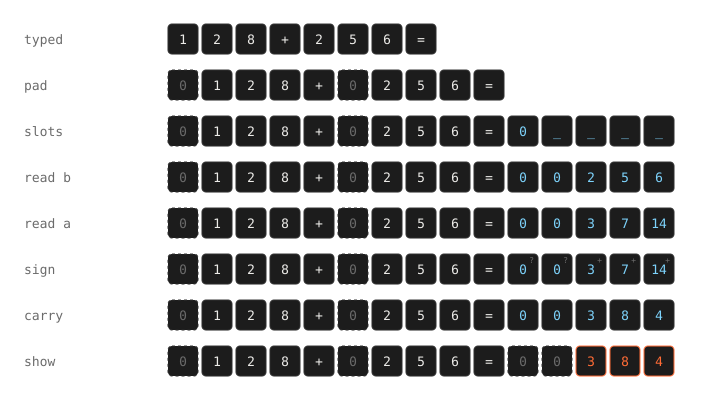

# How Carry works

Carry turns `128+256=` into `128+256=384` with OpenType GSUB substitutions and nothing else. This page explains the machine: what a shaping engine gives a font to work with, the one idea that makes multi-digit arithmetic possible, and each pass the font runs.

## What a font gets to work with

A font maps characters to glyphs through its `cmap` table. A shaping engine (HarfBuzz in Chrome, Firefox, and Android, CoreText in Safari and Mac apps) then runs the font's GSUB lookups over the glyph sequence, one lookup at a time, in a fixed order. GSUB rewrites glyphs. The text underneath never changes, so if GSUB turns `1 2 + 5 =` into `1 2 + 5 = 1 7`, the screen shows an answer that was never typed.

Carry uses five lookup types:

| Type | Name | What it does | Used for |
| --- | --- | --- | --- |
| 1 | Single | one glyph becomes another | every change of state |
| 2 | Multiple | one glyph becomes several | padding, answer slots |
| 4 | Ligature | several glyphs become one | the 100-ligature baseline only |
| 6 | Chaining contextual | runs another lookup when the surrounding glyphs match | every decision |
| 8 | Reverse chaining | like type 6, but walks right to left | carries |

The constraints are what shape the design:

- **Glyphs can't move.** A lookup can replace, insert, or delete glyphs, but it can't send a value somewhere else on the line.
- **No loops.** Each lookup runs once. Anything that needs more steps needs more lookups, decided when the font is built, so the maximum number of digits is a build setting.
- **Fixed shapes.** A contextual rule matches a fixed sequence of glyph sets. There is no "any number of glyphs".
- **The glyph is the only memory.** A position that must remember "column total 13, carry 1 coming in" needs a glyph that means exactly that.

Two engine behaviours make it possible. Both hold in HarfBuzz and CoreText, and `probe/probe.py` checks them:

1. **A lookup sees its own output.** A left-to-right chaining lookup matches its backtrack against glyphs it has already rewritten, and a reverse chaining lookup does the same with its lookahead. One lookup can carry state across the whole line.
2. **Contexts can be long.** Both engines match 100-glyph backtracks and lookaheads.

## The idea: make every distance a constant

To add `128+256`, you line the numbers up by their last digit and add column by column. The problem for a font is distance. How far the `8` sits from the answer depends on how long both numbers are, and a rule only matches a fixed shape.

So Carry pads both numbers to the same length with zero-width zeros. For a build that allows n digits, the line always looks like this once padding and answer slots are in place:

```
A[n-1] … A[0]   op   B[n-1] … B[0]   =   C   R[n-1] … R[0]
```

Answer slot `R[j]` finds `B[j]` exactly n + 2 non-skipped glyphs to its left, and `A[j]` exactly 2n + 3 non-skipped glyphs to its left, for every column and every pair of input lengths. Fetching the matching digit becomes a fixed-length context, which one chaining rule can match.



## The passes

Before arithmetic, syntax passes distinguish binary operators from unary signs and recognize spaces beside operators. These glyph variants retain the original outlines and advances. GDEF classifies the variants as ligatures so arithmetic lookups can skip them with `IgnoreLigatures`. Using marks instead would make HarfBuzz remove their advances.

Unary minus propagates through an operand's digit variants. Addition and subtraction read signed digit values, so column totals range from −18 to 18. Multiplication reads their magnitudes and handles the result sign separately. A negative full-width sum can require an extra minus glyph before its leading carry digit.

Boundary passes reject split numbers, malformed sign sequences, chains, and existing signed or spaced answers before allocating result slots.

Each pass consumes one family of glyphs and produces the next:

```
digits → pad → slot.* → b.* → col.* → col.*.z|p|n → d*.c*.p|n → res.*
```

The families never overlap, so a pass can't match glyphs from another stage. The snippets below come from a 4-digit build (`uv run generate.py --digits 4 --mul-digits 2`).

### Join

```
sub @JOINED @JOINED' lookup keep;
```

Before syntax tagging, adjacent digits, operators, equals signs, and ASCII or non-breaking spaces are replaced by themselves. This includes spaces and signs after `=` so typing an existing answer also invalidates the generated answer. Nothing visible changes. The matches mark boundaries unsafe to break, so an engine that reuses earlier shaping after an edit (Chromium does) reshapes the whole expression instead. See [engines.md](engines.md#chromium-reshapes-from-the-last-safe-break-after-an-edit).

### Pad

```
ignore sub [@DIGIT @WORD period comma] @DIGIT';
sub @DIGIT' lookup pad3 @ADDOP;
sub @ADDOP @DIGIT' lookup pad3 equal;
sub @DIGIT' lookup pad2 @DIGIT @ADDOP;
```

The first digit of each number looks ahead, counts the digits that follow it, and puts zero-width `pad` glyphs in front of itself. `pad3` is a multiple substitution, `sub one by pad pad pad one`. The `ignore` rule stops a digit after another digit, a letter, `_`, `.`, or `,` from counting as the start of a number, so `x2+3=` and `1.5+2=` draw nothing.

### Slots

```
sub @PADDED @PADDED @PADDED @PADDED plus @PADDED @PADDED @PADDED @PADDED equal' lookup expand_add;
```

An `=` after two padded numbers becomes `=` plus a carry slot plus n answer slots. Guard rules in the same lookup match first when the answer is already typed (`12+3=15`), a number is too long, or the expression is a chain like `1+2+3=`. Carry draws nothing rather than a wrong answer.

### Read B, then read A

```
sub @VAL5 @ANY @ANY @ANY @ANY @ANY [slot.add slot.sub]' lookup take_b5;
```

If the glyph n + 2 non-skipped places to the left is a 5, the slot now holds +5 (or −5 in a subtraction). Signed variants reverse that contribution. There is one rule per nonzero digit and polarity. A pad reads as zero through a fallback rule with no context, because long contexts cost HarfBuzz shaping budget only when they match. The second pass reads A, 2n + 3 places away, and adds it. Every slot now holds a column total from −18 to 18.

### Sign

```
sub [equal @SIGZ] @COL' lookup sign_z;
sub @SIGP @COL' lookup sign_p;
sub @SIGN @COL' lookup sign_n;
```

For subtraction, the font must know whether the answer is negative before it writes digits. The most significant nonzero column decides, because all the columns after it are worth less than one unit of it. Left to right, each slot copies the sign of the first nonzero column before it, and the last slot ends up knowing the sign of the whole answer.

### Carry

```
rsub @SIG' [d0.c1.p d1.c1.p … d9.c1.p] by [...];
```

A carry comes from the right, so this pass walks right to left with reverse chaining. Each slot reads the carry its right neighbour just produced, settles into one digit, and passes its own carry left: a ripple-carry adder made of substitutions. A negative answer negates every column first, so `5-7=` computes 7 − 5, and carries stay between −1 and +1. The substitution tables come from one function in `generate.py`:

```python
def settle(v: int, sign: str, carry_in: int) -> tuple[int, int, str]:
    e = (-v if sign == "n" else v) + carry_in
    return e % 10, max(-1, min(1, e // 10)), sign
```

### Show

Leading zeros become zero-width `blank` glyphs, the carry slot of a negative answer becomes a minus sign, and every other slot becomes a `res.*` digit with the same outline as a typed digit.

`generate.py` also builds Carry Debug, which gives the zero-width glyphs an outline and a width so you can see them:

<picture>
  <source media="(prefers-color-scheme: dark)" srcset="images/hidden-dark.svg">
  
</picture>

## Exact decimals

Decimal expressions use `DecimalSpec` and `DecimalMachine` in `decimal_features.py`. The shared `Glyph` and `Pass` records live in `font_model.py`. Expressions without a decimal point keep the original integer layout.

The decimal machine recognizes each operand's format independently. A decimal operator selects the wider layout, and hidden zeros align both operands to two fractional places. Source digits and decimal points keep their original outlines and advances; tagged points become skippable ligatures only after padding.

For example, `1.2+0.03=` computes integer coefficients 120 and 3, then displays coefficient 123 at scale two as `1.23`. The addition layout has 18 columns for 16 integer and two fractional digits. Multiplication allows ten coefficient digits per operand, so its result has scale four. `1.25×0.4=` computes 125 × 40 = 5000 and displays `0.5`.

End markers fix the result's radix position before formatting removes zeros. Output passes distinguish integer, units, and fractional columns. They retain the units zero in a fraction, remove only trailing fractional zeros, and hide the point when no fractional digits remain. The sign passes suppress negative zero. No rounding or floating-point arithmetic occurs.

Numbers require digits on both sides of a decimal point. Inputs with more than two fractional digits or too many integer digits draw no result.

## Multiplication

Long multiplication, one row per digit of B, three passes per row:

1. **Spread.** The first slot reads one digit of B. Every later slot copies it from its left neighbour in the same pass.
2. **Multiply.** Every slot reads the A digit that lines up with it in this row, at a fixed distance, and adds A digit × B digit to the digit it holds. Totals run from 0 to 90.
3. **Carry.** A reverse chaining pass settles each total into one digit, with carries from 0 to 9.

Row j needs `A[k-j]`, and for some slots that index is out of range. Both numbers are padded to twice their length, so every out-of-range read lands on a pad or the operator and reads as zero. Validation requires at least m leading pads on each number, which rejects a 2m-digit number that would otherwise fill the block unpadded.

## Integer division

`DivisionSpec` and `DivisionMachine` in `division_features.py` implement four-digit decimal long division. The shared syntax passes recognize `/` and `÷`, preserve unary signs and spacing, and pad each operand to four logical digits. A separate validation pass rejects zero divisors, decimal operands, oversized numbers, typed answers, and expression chains before creating result slots.

The workspace contains a four-digit quotient, a five-digit remainder, and five scratch cells for subtraction and borrows. It consumes the dividend's digits from left to right. Each digit shifts the remainder and brings down one source digit, then runs exactly nine trial subtractions of the divisor. A nonnegative trial updates the remainder and increments the current quotient digit.

Before bringing down a digit, the remainder is less than the divisor. Afterward, it is less than ten times the divisor. Nine successful subtractions therefore cover every possible quotient digit. The generator unrolls all 36 trials into lookup passes. The number of scheduled trials depends on the digit limit, not the numeric quotient.

Scheduled passes call shared contextual kernels through distinct wrappers. This keeps the font below HarfBuzz's contextual-subtable sanitizer limit without relying on engines to repeat the same feature lookup index. Division lookups use extension offsets to fit the combined table. `Pass.use_extension` records that requirement explicitly.

Arithmetic first computes unsigned quotient and remainder. Sign passes negate a nonzero quotient when operand signs differ, and negate a nonzero remainder when the dividend is negative. Thus `-17÷5=` draws `-3 r -2`, because −17 = (−3 × 5) + (−2). There is no negative zero.

Formatting strips generated leading zeros and omits a zero remainder. The final pass expands the remainder separator into three ordinary glyphs for ` r `. A single wide glyph with the same outline produced different browser rasterization. Division's fixed-workspace lookups finish before that expansion.

## What it costs

Glyph families have fixed sizes, so the glyph count does not grow with the number of digits. Width goes into longer contexts and more passes instead. These measurements describe version 1.0's unsigned-integer machine, before the syntax extension. Measured on an Apple M4, within one run of `scripts/sweep.py`:

| Max digits (all operators) | Lookups (passes) | TTF bytes | Longest sum, HarfBuzz | Longest product, HarfBuzz |
| --- | --- | --- | --- | --- |
| 4 | 77 (20) | 55,932 | 7 µs | 73 µs |
| 8 | 97 (32) | 64,528 | 23 µs | 351 µs |
| 16 | 137 (56) | 92,952 | 70 µs | 2,525 µs |
| 24 | 177 (80) | 153,412 | 119 µs | 7,208 µs |

In that run, doubling from 8 to 16 digits made the longest sum about 3× slower and the longest product about 7× slower. Version 1.0 used 16 digits for `+` and `-` and 8 for `×` and `*`, which came to 65,696 bytes.

The full design history, with every dead end, is in [journal.md](journal.md).
